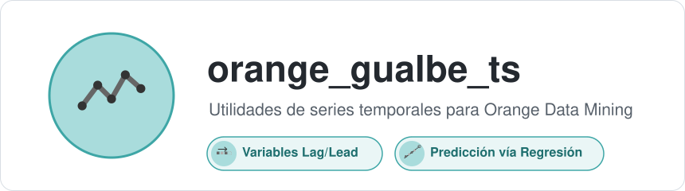
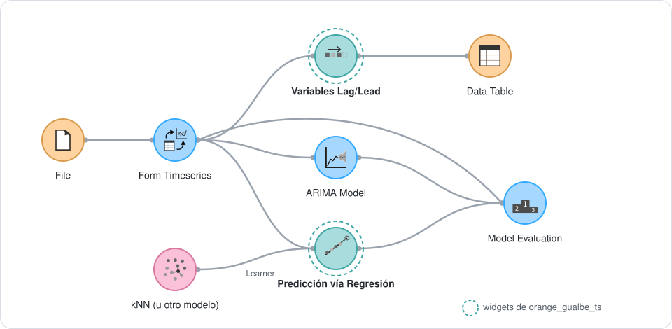
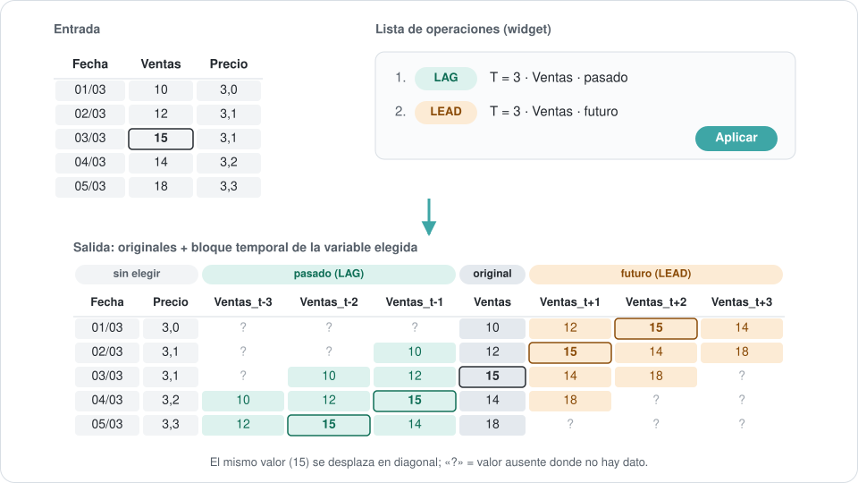
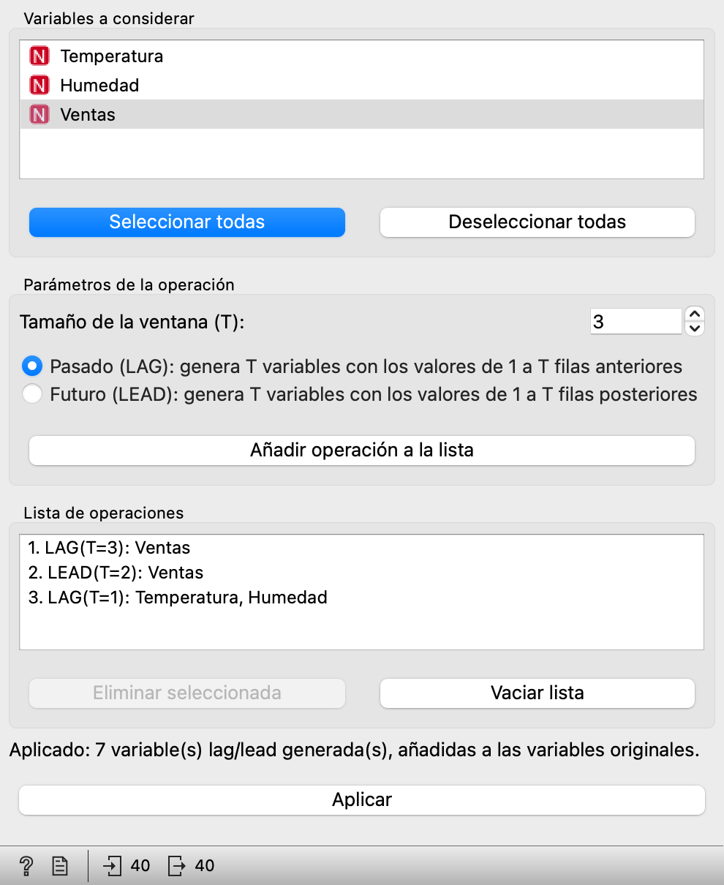
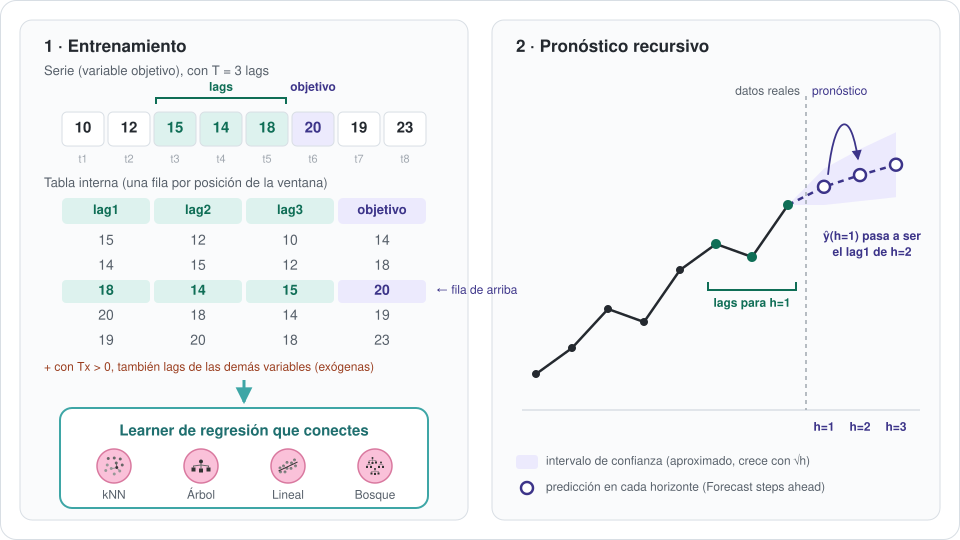
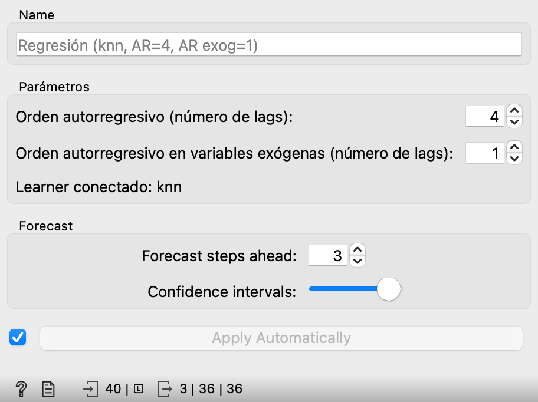

<p align="center">
  
</p>

<p align="center">
  <a href="https://pypi.org/project/orange-gualbe-ts/"></a>
  <a href="https://github.com/gualbe/orange_gualbe_ts/actions/workflows/publish.yml"></a>
  <a href="https://github.com/gualbe/orange_gualbe_ts/blob/main/LICENSE"></a>
  <a href="https://orangedatamining.com/"></a>
</p>

Add-on para [Orange Data Mining](https://orangedatamining.com/) que añade
la categoría **Utilidades de Series Temporales** al lienzo, con widgets
para preparar series temporales y para pronosticarlas con cualquier
modelo de regresión de Orange. Trabaja sobre las series temporales del
add-on [Orange3-Timeseries](https://orange3-timeseries.readthedocs.io/),
del que depende.

| Widget | Para qué sirve |
| --- | --- |
| **Variables Lag/Lead** | Añade a la tabla copias desplazadas de las variables elegidas: valores de *t-1 … t-T* (pasado) y *t+1 … t+T* (futuro). |
| **Predicción vía Regresión** | Pronostica la serie con kNN, Árbol, Regresión Lineal, Bosque Aleatorio… usando sus propios lags. Se compara con ARIMA y VAR en *Model Evaluation*. |

## Instalación

Desde Orange: menú **Options → Add-ons…**, botón **Add more…**, escribe
`orange_gualbe_ts` y reinicia Orange.

O con `pip`, en el mismo entorno de Python que Orange (instala también
Orange3-Timeseries):

```bash
pip install orange_gualbe_ts
```

## Flujo de trabajo típico

<p align="center">
  
</p>

1. **Form Timeseries** convierte la tabla en serie temporal. Los dos
   widgets solo aceptan series temporales: el lienzo no deja conectar una
   tabla normal.
2. **Variables Lag/Lead** añade variables desplazadas en el tiempo, por
   ejemplo para usarlas después como atributos de cualquier modelo.
3. **Predicción vía Regresión** recibe la serie y un modelo del panel
   *Model* por su entrada *Learner*. Su salida *Time series model* se
   conecta a **Model Evaluation**, junto con ARIMA o VAR, para comparar
   errores. *Model Evaluation* también necesita la serie, desde Form
   Timeseries (enlace superior del esquema).

## Variables Lag/Lead

Cada operación indica **variables**, **tamaño de ventana T** y
**dirección** (pasado o futuro). Las operaciones se acumulan en una lista
y se ejecutan juntas al pulsar **Aplicar**.

<p align="center">
  
</p>

- Una ventana **T** genera **T variables**: `Ventas_t-1 … Ventas_t-3` en
  pasado, `Ventas_t+1 … Ventas_t+3` en futuro (como `LAG()`/`LEAD()` en
  SQL o `shift()` en pandas).
- Se **conservan todas las variables originales**. El orden de columnas
  es fijo: primero las variables no elegidas y luego, por cada variable
  elegida, su bloque del pasado más lejano al futuro más lejano, con la
  original en el centro.
- Donde no hay dato (primeras filas de un LAG, últimas de un LEAD) queda
  un valor ausente de Orange (`?`).
- Si dos operaciones piden la misma variable y dirección, no se duplican
  columnas: se usa el T mayor.
- Admite atributos y variable objetivo de cualquier tipo (continuas,
  discretas o temporales), pero no metadatos. La variable temporal no se
  desplaza.

<p align="center">
  
</p>

## Predicción vía Regresión

Funciona como los widgets **ARIMA Model** y **VAR Model** (mismas
salidas y controles de horizonte y confianza), pero el algoritmo lo
pones tú: cualquier modelo de regresión del panel *Model* de Orange, con
su configuración.

<p align="center">
  
</p>

**Entradas:** *Time series* (serie con variable objetivo continua) y
*Learner* (salida de kNN, Tree, Linear Regression, Random Forest, SVM,
Neural Network…).

**Salidas:** *Time series model* (para *Model Evaluation*), *Forecast*
(predicción con intervalo de confianza), *Fitted values* y *Residuals*.

**Parámetros:**

| Parámetro | Qué controla |
| --- | --- |
| Orden autorregresivo (T) | Cuántos valores anteriores de la serie se usan como atributos. |
| Orden autorregresivo en variables exógenas (Tx) | Opcional (0 = desactivado). Añade los Tx valores anteriores de las demás variables de la tabla. |
| Forecast steps ahead | Cuántos pasos futuros se pronostican. |
| Confidence intervals | Nivel de confianza del intervalo. |

**A tener en cuenta:**

- El pronóstico de varios pasos es **recursivo**: cada predicción se
  reutiliza como dato para el paso siguiente, igual que en ARIMA y VAR.
- El futuro de las variables exógenas no se conoce. A partir del segundo
  paso se mantiene su último valor observado.
- El intervalo de confianza es **aproximado** (desviación de los residuos,
  creciente con √h): un modelo de regresión genérico no tiene una fórmula
  exacta como ARIMA o VAR. Por eso *Model Evaluation* muestra AIC y BIC
  como error para este modelo; el resto de métricas se calculan con
  normalidad.

<p align="center">
  
</p>

## Ayuda dentro de Orange

Selecciona un widget en el lienzo y pulsa **F1**, o el icono **?** de su
barra de estado, para abrir su documentación.

## Desarrollo

```bash
git clone https://github.com/gualbe/orange_gualbe_ts.git
cd orange_gualbe_ts
python -m venv .venv && source .venv/bin/activate
pip install Orange3 PyQt5 Orange3-Timeseries sphinx
pip install -e .
python -m Orange.canvas
```

**Ayuda (F1).** Se genera con [Sphinx](https://www.sphinx-doc.org/) desde
`doc/`, dentro del propio paquete, para que funcione también instalada
desde PyPI:

```bash
python -m sphinx -b html doc orangecontrib/orange_gualbe_ts/_help/html
```

Cada widget tiene su página `doc/widgets/<nombre>.rst`, que empieza con
una etiqueta igual al nombre del widget en minúsculas (por ejemplo,
`.. _variables lag/lead:`). Así la encuentra Orange. La carpeta `_help/`
es generada y no se versiona.

**Imágenes de este README.** Están en `assets/` y se regeneran con:

```bash
python assets/generar_imagenes.py --capturas
```

## Publicar una versión nueva

La publicación en PyPI es automática mediante
[Trusted Publishing](https://docs.pypi.org/trusted-publishers/). Al
publicar una release en GitHub, el workflow
`.github/workflows/publish.yml` genera la ayuda, construye el paquete,
lo sube a PyPI sin tokens y adjunta los ficheros a la release. Así
GitHub y PyPI no pueden quedar desincronizados.

1. Sube `version` en `pyproject.toml` y haz commit y push a `main`.
2. Crea la release con una etiqueta `v` + la misma versión:

   ```bash
   gh release create v0.2.3 --title "v0.2.3" --notes "Cambios de esta versión"
   ```

El workflow rechaza la publicación si la etiqueta no coincide con la
versión de `pyproject.toml`. Para validar la construcción sin publicar,
lánzalo a mano desde la pestaña *Actions* o con
`gh workflow run publish.yml`.

## Licencia y autoría

**Autor:** Gualberto Asencio Cortés · Copyright © 2026.

`orange_gualbe_ts` es software libre bajo la licencia
[GPL-3.0-or-later](https://github.com/gualbe/orange_gualbe_ts/blob/main/LICENSE)
(GNU GPL versión 3 o posterior), la misma familia de licencia que Orange y
Orange3-Timeseries, de los que el add-on importa y hereda clases.

Además, al amparo del artículo 7 de la GPL-3, el fichero
[`NOTICE`](https://github.com/gualbe/orange_gualbe_ts/blob/main/NOTICE) añade
unos términos adicionales que se aplican al material del autor:

- **Atribución (7 b):** toda copia o versión modificada, completa o parcial, debe
  conservar el aviso de copyright y la atribución de autoría a Gualberto Asencio
  Cortés en los ficheros fuente, en la documentación y en `NOTICE`.
- **Origen y versiones modificadas (7 c):** no se puede falsear el origen del
  material; las versiones modificadas deben marcarse como distintas del original
  y no pueden presentarse como el add-on original ni como publicadas o
  respaldadas por su autor.
- **Nombres (7 e):** no se concede ningún derecho sobre los nombres
  «orange_gualbe», «Orange Gualbe» ni «Gualbe».

**Forks y versiones derivadas.** Puedes estudiar, modificar y redistribuir el
código en los términos de la GPL-3, pero si distribuyes una versión modificada
debes publicarla con otro nombre de paquete y de proyecto (que no contenga esos
nombres), indicar que es una versión modificada de `orange_gualbe_ts` y no
presentarla como oficial ni como obra del autor.

**Cómo citar.** Si usas el add-on en un trabajo académico, cítalo con los
metadatos de [`CITATION.cff`](https://github.com/gualbe/orange_gualbe_ts/blob/main/CITATION.cff)
(GitHub ofrece «Cite this repository» con el formato APA o BibTeX), por ejemplo:

> Asencio Cortés, G. (2026). *orange_gualbe_ts: utilidades de series temporales
> para Orange Data Mining* (versión 0.2.4) [Software].
> https://github.com/gualbe/orange_gualbe_ts

**Componentes de terceros.** El add-on depende de Orange Data Mining y de
Orange3-Timeseries (ambos GPL-3.0 o posterior, Bioinformatics Laboratory,
Universidad de Liubliana) y de NumPy y SciPy (BSD-3-Clause), que se instalan
aparte. El método `update_learner()` del widget Predicción vía Regresión es una
versión breve modificada del de `OWBaseModel` de Orange3-Timeseries; no se ha
copiado más código de Orange, de Orange3-Timeseries ni de otros proyectos. Los
iconos de Orange y Orange3-Timeseries que aparecen en los esquemas de este README
pertenecen a sus autores y se distribuyen bajo GPL-3.0 o posterior como parte de
esos proyectos.
